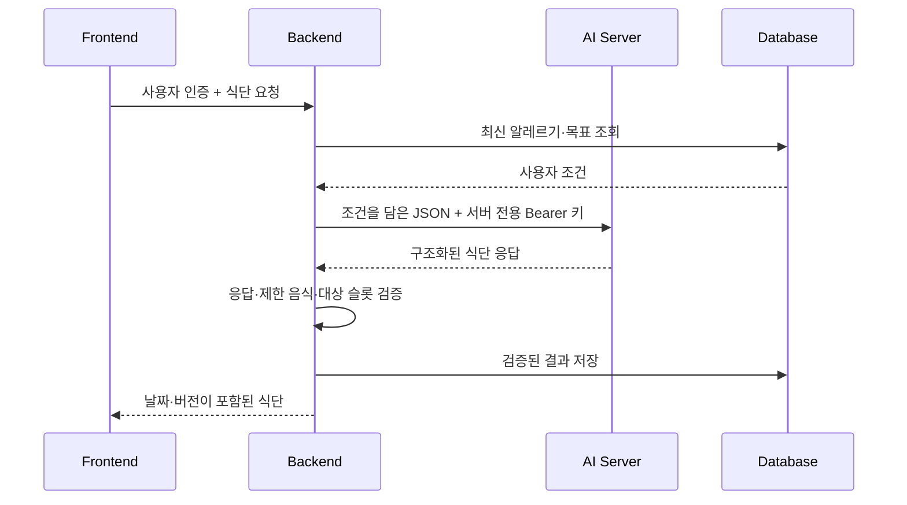

# Auto-Fit · AI 연동 개발자 가이드

**Backend ↔ AI Server** · 전달자료 v1 · 2026-10-19

모델 개발 담당자가 요청 형식과 응답 구조를 빠르게 확인할 수 있도록 정리한 문서입니다.
**식단은 월요일부터 일요일까지 7일 × 4끼, 총 28끼를 저장하는 방향입니다.**

> **현재 상태**
>
> 문서와 합성 예시를 공유한 단계입니다. 주간 식단의 백엔드 로컬 구현은 완료됐으며,
> 실제 AI 서버 통합 검증·DB 적용·서버 배포는 아직 완료되지 않았습니다.
> 아래 OpenAPI에는 로컬 구현이 포함되므로 운영 서버의 지원 여부와 구분해 주세요.

[전달 파일](#전달-파일) · [요청 예시](#백엔드가-ai에-보내는-요청) · [응답 구조](#ai가-반환할-식단-구조) · [확인할 항목](#모델-담당자와-확인할-항목)

## 전달 파일

| 파일 | 담고 있는 내용 | 확인할 때 |
|---|---|---|
| [backend-openapi.json](backend-openapi.json) | 백엔드 API·요청/응답 DTO 발췌 | 백엔드 경로, 타입, 필수값, null 허용 여부 확인 |
| [backend-examples.json](backend-examples.json) | 건강 입력·기존 챗봇·기존 일일 식단의 합성 예시 | 현재 백엔드 데이터 구조 파악 |
| [weekly-diet-example.json](weekly-diet-example.json) | 새로운 주간 식단의 **7일 전체 AI 응답** 예시 | 응답 fixture 및 28끼 구조 검증 |
| [ai-request-examples.json](ai-request-examples.json) | 생성·한 끼 교체·Recipe의 **백엔드 → AI 입력** | 실제 전송할 JSON body 확인 |

**추천 확인 순서:** 이 가이드 → `ai-request-examples.json` → `weekly-diet-example.json` → OpenAPI.
모든 예시는 합성 데이터이며 실제 사용자 정보나 API 키를 포함하지 않습니다.
`backend-examples.json`의 기존 일일 식단 예시와 새로운 주간 식단 응답은 서로 다른 계약입니다.

## 요청과 저장 흐름



| 책임 | Backend | AI Server |
|---|---|---|
| 사용자 상태 | 인증, 최신 조건 조회, 소유권 확인 | 전달받은 조건 사용 |
| 결과 생성 | 요청 구성 | 식단·끼니·레시피 생성 |
| 저장 | 응답 검증 후 DB 저장, 동시 수정 제어 | 사용자 DB에 직접 접근하지 않음 |
| 날짜·버전 | KST 주 시작일, plan ID, version 관리 | 요일과 식사 유형 반환 |

## 백엔드가 AI에 보내는 요청

### 1. 주간 식단 생성

**`POST /recommend/diet`**

```http
Authorization: Bearer <AI_SERVER_API_KEY>
Content-Type: application/json
```

```json
{
  "metric_statuses": {},
  "food_allergens": [
    "땅콩"
  ],
  "disliked_foods": [
    "가지"
  ],
  "goal_type": "weight_loss",
  "additional_input": "간이 강하지 않은 식단",
  "sido": null,
  "sigungu": null,
  "nearby_regions": [],
  "meal_target": {
    "calories_kcal": 550.0,
    "protein_g": 30.0,
    "fat_g": 18.0,
    "carbohydrate_g": 70.0
  }
}
```

| 필드 | 형식 | 현재 전송 기준 |
|---|---|---|
| `metric_statuses` | object | 현재 `{}`. 건강 상태 매핑 전이며 질환을 추정하지 않음 |
| `food_allergens` | string[] | 인증 사용자의 최신 알레르기 |
| `disliked_foods` | string[] | 해당 주 계획의 기피 음식. 알레르기와 별도 관리 |
| `goal_type` | string 또는 null | 저장된 사용자 목표 |
| `additional_input` | string 또는 null | 사용자가 입력한 추가 조건 |
| `sido` / `sigungu` | null | 지역 연결 전 |
| `nearby_regions` | array | 현재 `[]` |
| `meal_target` | object 또는 null | 사용자가 지정한 **한 끼** 열량·영양 목표 |

`meal_target`의 열량 단위는 kcal, 영양소 단위는 g입니다.
사용자 ID·plan ID·`week_start_date`·`expected_version`은 이 AI 요청에 포함하지 않습니다.

### 2. 한 끼 교체

**`POST /recommend/diet/replace-meal`**

생성 요청의 공통 조건에 아래 필드를 추가합니다.

| 추가 필드 | 예시 | 의미 |
|---|---|---|
| `target_day` | `monday` | 교체할 요일 |
| `target_meal` | `lunch` | 교체할 끼니 |
| `current_menu_name` | `monday lunch` | 현재 메뉴명. 예시는 fixture의 합성 이름 |
| `excluded_menu_names` | 기존 주간 메뉴명 배열 | 중복 이름을 제거한 제외 목록 |
| `current_ingredients` | `[]` | 확인된 재료가 없어 빈 배열 전달 |

완전한 body는 [요청 예시의 두 번째 항목](ai-request-examples.json)에 있습니다.
응답은 `{ok, generator, meal}`이며, `meal` 안에 `{day, meal_type, meal}`을 포함합니다.
반환한 요일·끼니가 요청 대상과 일치해야 합니다.

### 3. 선택한 끼니의 Recipe

**`POST /recommend/diet/recipe`** · 입력 builder 준비 / 공개 API 미연결

```json
{
  "items": [
    {
      "food_name": "현미밥",
      "portion_g": 100.25,
      "calories_kcal": 165.5,
      "carbohydrate_g": 35.25,
      "protein_g": 3.5,
      "fat_g": 1.25
    }
  ],
  "food_allergens": [
    "땅콩"
  ],
  "disliked_foods": [
    "가지"
  ]
}
```

선택한 끼니의 `items`를 그대로 전달합니다. 소수 수치와 항목 순서를 보존합니다.
최상위 응답 구조와 정상·충돌·`unavailable` 예시를 확인한 뒤 연결할 예정입니다.

<details>
<summary><strong>요청 예시 파일 사용 방법 · 펼쳐 보기</strong></summary>

`ai-request-examples.json`의 `requests` 배열에서 대상 항목의 **`body`만** 전송합니다.
`description`, `status`, `backend_generate` 등은 전달자료의 설명용 필드입니다.
`implemented`는 백엔드 로컬 구현 상태이며 원격 AI의 지원 상태를 의미하지 않습니다.

다음 명령은 저장소 루트에서 생성 요청 body를 추출합니다. 실제 API 호출은 하지 않습니다.

```sh
jq '.requests[] | select(.path == "/recommend/diet") | .body' \
  docs/ai-integration/ai-request-examples.json > /tmp/autofit-diet-request.json
```

</details>

## AI가 반환할 식단 구조

```text
{ ok, generator, result }
└── result
    ├── summary
    ├── strategy
    └── weekly_plan[7]
        ├── day
        └── meals
            ├── breakfast
            ├── lunch
            ├── dinner
            └── snack
                ├── menu_name / menu_description
                ├── estimated_calories_kcal / nutrition
                └── items[]
```

네 끼 모두 동일한 Meal 구조를 사용합니다. 전체 검증용 응답은
[weekly-diet-example.json](weekly-diet-example.json)을 사용해 주세요.
아래는 **한 끼만 발췌한 예시**로, 전체 응답 body가 아닙니다.

```json
{
  "menu_name": "monday lunch",
  "menu_description": "합성 음식",
  "estimated_calories_kcal": 165.5,
  "nutrition": {
    "carbohydrate_g": 35.25,
    "protein_g": 3.5,
    "fat_g": 1.25
  },
  "items": [
    {
      "food_name": "현미밥",
      "portion_g": 100.25,
      "calories_kcal": 165.5,
      "carbohydrate_g": 35.25,
      "protein_g": 3.5,
      "fat_g": 1.25
    }
  ],
  "image_prompt": null,
  "ingredients": null,
  "guidance": "합성 예시"
}
```

| 검증 항목 | 계약 |
|---|---|
| 요일 | `monday` → `sunday` 순서로 정확히 7개 |
| 끼니 | 매일 `breakfast`, `lunch`, `dinner`, `snack` 모두 포함 |
| 음식 항목 | 각 Meal의 `items` 필수, 최소 1개 |
| 수치 | `portion_g`는 양수, 열량·영양소는 0 이상, 유한한 JSON 숫자 |
| 정밀도 | 원본 소수 수치 보존 |
| 재추천 | 요청한 요일·끼니와 일치하고 기존 메뉴 제외 조건 충족 |
| 재료 구분 | `ingredients`를 `items`의 대체 필드로 사용하지 않음 |

## 백엔드 API 빠른 참조

아래 경로는 **프론트 → 백엔드**용 로컬 구현 계약입니다. AI 호출 경로와 구분해 주세요.
인증은 사용자 Bearer 토큰을 사용합니다.

| Method | 경로 | 요청 / 결과 |
|---|---|---|
| POST | `/api/diet/weekly-recommendations/generate` | 신규 생성 201, 전체 재생성 200 |
| GET | `/api/diet/weekly-recommendations?week_start_date=2026-10-19` | 해당 주 조회 |
| GET | `/api/diet/weekly-recommendations/{plan_id}` | plan ID로 조회 |
| POST | `/api/diet/weekly-recommendations/{plan_id}/meals/{day}/{meal_type}/regenerate` | `{"expected_version": 1}`로 한 끼 교체 |

주 시작일은 KST 기준 월요일입니다. 기존 주 전체를 재생성할 때도 일치하는 `expected_version`을 보냅니다.
동시 수정 또는 저장 후 알레르기·목표 변경은 409이며, 다시 조회하거나 전체 재생성이 필요합니다.
새 주간 저장 구조와 기존 일일 식사 기록의 연결은 후속 작업입니다.

<details>
<summary><strong>실패 응답과 재시도 기준 · 펼쳐 보기</strong></summary>

| 상황 | 백엔드 응답 / 처리 |
|---|---|
| 잘못된 프론트 요청 | 422 |
| 없는 계획 또는 타인 계획 | 404 |
| 중복 생성·버전·사용자 조건 충돌 | 409 |
| 사용자 호출 한도 초과 | 429 + `Retry-After` |
| AI 응답 형식 오류 | 502 `AI_INVALID_RESPONSE`, 저장하지 않음 |
| AI 제한 음식 충돌 | 502 `AI_FOOD_RESTRICTION_CONFLICT`, 저장하지 않음 |
| AI 인증·검증·내부 오류(401/422/500) | 백엔드 502 |
| AI 503·연결 실패·timeout | 백엔드 503 |

생성 요청은 자동 재시도하지 않습니다. 현재 socket timeout은 60초, 전체 호출 예산은 65초,
응답 크기 제한은 2 MiB입니다. 서버 간 키와 AI 원문 오류는 프론트에 노출하지 않습니다.

</details>

## 모델 담당자와 확인할 항목

확인 기준: 원격 `ai` 브랜치 커밋
[`1ebb6a2`](https://github.com/gahya9904/Auto-Fit/commit/1ebb6a2f9eac1e1c49e95aa573ea76e46b1ababe).
첨부 명세와 해당 코드 사이에 아래 차이가 있습니다. 실제 배포 서버는 별도 검증이 필요합니다.

| 확인할 내용 | 확인한 코드 상태 | 필요한 자료 / 결정 |
|---|---|---|
| 주간 식단 | 응답 `items`, 요청 기피 음식·지역·영양 목표 없음 | 명세를 반영한 코드 버전 |
| 한 끼 교체 | `excluded_menu_names` 없음 | 제외 메뉴 반영 여부 |
| Recipe | 추천 router에 경로 없음 | 정상·충돌·unavailable 전체 응답 |
| 채팅 적용 | `pending_action`, `action_status`, `requires_backend_apply` 없음 | action 상태 전이·확인·취소 계약 |
| 건강 분석·운동 추천 | 경로와 DTO 확인, 백엔드 연결 미완료 | 저장 구조와 필드 매핑 |

소스: [추천 DTO](https://github.com/gahya9904/Auto-Fit/blob/1ebb6a2f9eac1e1c49e95aa573ea76e46b1ababe/app/schemas/recommendation.py) ·
[추천 router](https://github.com/gahya9904/Auto-Fit/blob/1ebb6a2f9eac1e1c49e95aa573ea76e46b1ababe/app/routers/recommendation_router.py) ·
[채팅 DTO](https://github.com/gahya9904/Auto-Fit/blob/1ebb6a2f9eac1e1c49e95aa573ea76e46b1ababe/app/schemas/chat.py).

---

**문서 관리:** 필드·경로·null 규칙·배포 상태가 바뀌면 이 가이드와 JSON 예시를 함께 갱신합니다.
