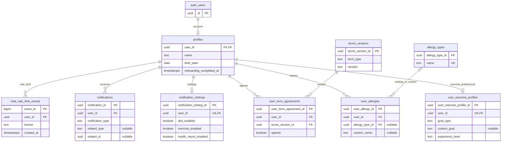
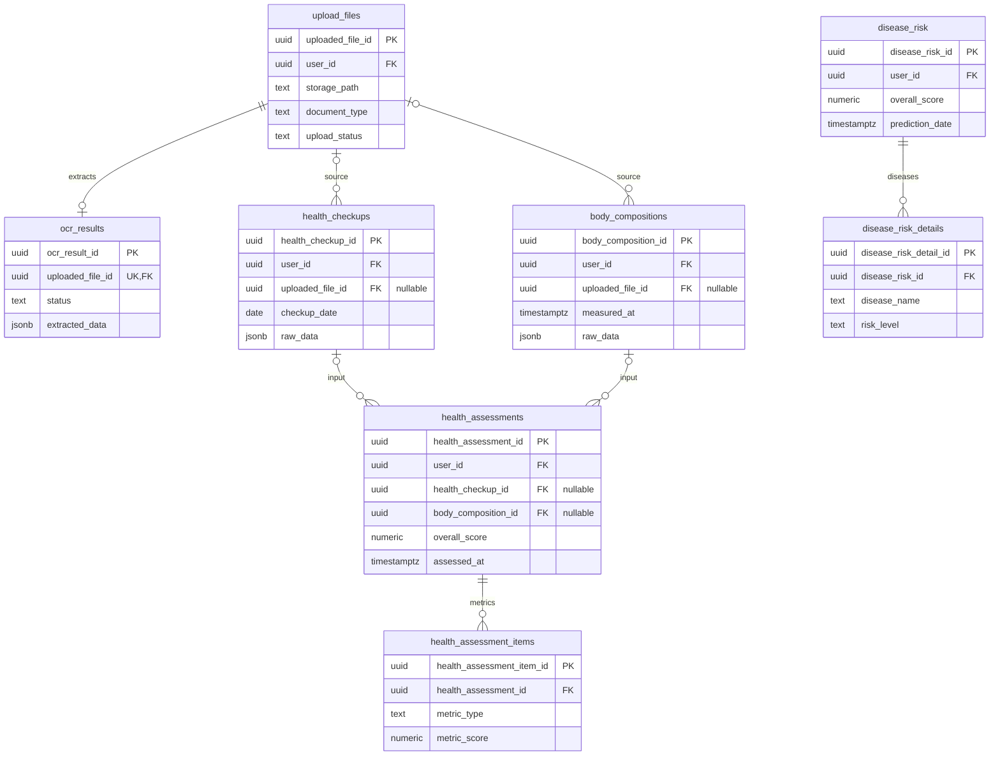
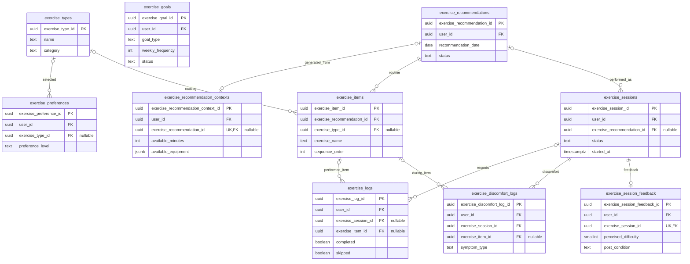
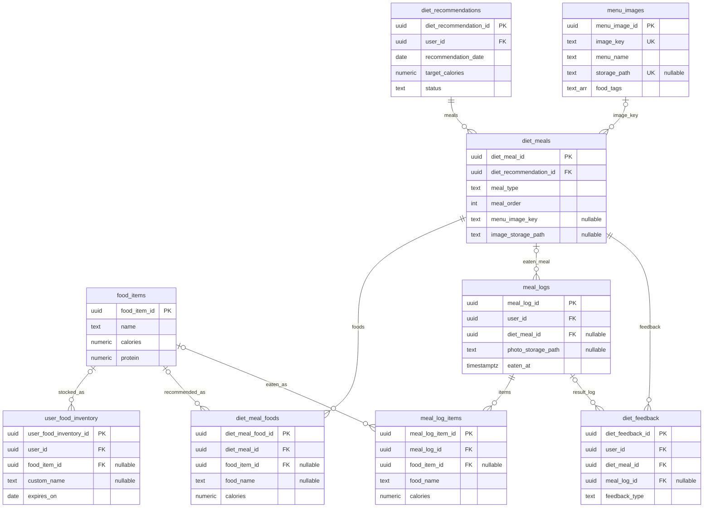
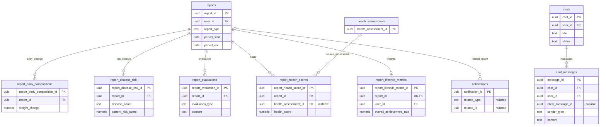

# Auto-Fit ERD (현재 구현 기준)

기준일: 2026-09-22. `supabase/migrations/20260901055003_remote_schema.sql`부터 `20260917021925_cascade_account_deletion.sql`까지의 저장소 마이그레이션과 `docs/openapi.json`을 대조했다. **현재 저장소에 정의된 구조**를 나타내며, 운영 DB에 적용된 마이그레이션 상태를 직접 조회한 결과는 아니다.

## 범위와 표기

- `public`의 업무 테이블 **44개**, 외부 인증 주체 `auth.users` 1개를 도식화했다. `autofit_integrity.business_references`와 `autofit_integrity.account_deletions`는 무결성·탈퇴 절차용 내부 테이블이므로 본문 관계도 대신 아래 운영 메모에 기록했다.
- `auth_users`는 `auth.users`를 도식에 표기한 이름이다. `PK`는 기본 키, `UK`는 유일 키다. Mermaid의 `FK` 표시는 이 문서에서 **논리적 참조**를 뜻하며 물리적 FK 제약을 뜻하지 않는다. 그림의 선은 **관계의 의미**를 나타낸다. 현재 업무 테이블에는 물리적 `FOREIGN KEY`가 없으며, 사용자·업무 참조는 `autofit_integrity` 트리거가 검사한다. `diet_meals.menu_image_key → menu_images.image_key`는 캐시 키로 연결되지만 참조 트리거 대상은 아니다.
- `||--o{`는 부모 한 건에 자식 0건 이상, `||--o|`는 자식 최대 1건을 뜻한다. 선택적인 참조 컬럼은 각 엔터티에서 `nullable`로 표시했다. 도식은 핵심 컬럼만 싣고 전체 컬럼은 SQL 마이그레이션을 원본으로 삼는다.
- 여러 테이블의 `user_id`는 `profiles.user_id`와 같은 사용자를 가리킨다. 도식의 혼잡을 줄이기 위해 각 영역의 사용자 소유 관계는 선 대신 `user_id` 컬럼과 [사용자 소유 테이블](#사용자-소유-테이블)에 모았다.

## 1. 계정·온보딩·알레르기·알림

`user_allergies`는 기준 알레르기 ID 또는 직접 입력한 `custom_name`을 가진다. `notification_settings.user_id`는 사용자별 설정을 뜻하며, 설정 삭제 처리에는 별도 트리거가 있다. `notifications.related_type='report'`일 때만 `related_id`가 아래 `reports.report_id`를 가리키도록 검사된다.

## 2. 건강 문서·측정·분석

`disease_risk`는 사용자 단위의 별도 예측 결과이며 `health_assessments`를 직접 참조하지 않는다. 문서 확인 API는 검토한 OCR 값을 `health_checkups` 또는 `body_compositions`에 저장한다.

## 3. 운동 추천·수행

추천 입력 `exercise_recommendation_contexts`는 생성 전에는 추천 ID가 비어 있다. `exercise_logs`는 독립 운동 기록도 허용하므로 세션·항목 ID가 모두 선택값이다. 세션과 항목을 함께 지정하면 같은 추천에 속하는지 추가 트리거가 확인한다. `exercise_goals`는 현재 운동 목표 기록이며 추천과 직접 연결된 컬럼은 없다.

## 4. 식단 추천·섭취·재료

`menu_images.image_key` 연결은 앱/RPC가 해석하는 캐시 키이며 DB 참조 제약은 없다. `meal_logs.photo_storage_path`는 Storage 객체 경로다. `user_food_inventory`는 카탈로그 음식 또는 직접 입력한 이름을 가진다.

## 5. 리포트·챗봇

`notifications`의 리포트 연결은 `related_type='report'`일 때만 유효한 다형 참조다. `chat_messages`에는 재전송 식별자와 응답 출처·근거 JSON 컬럼도 있다. 채팅 메시지는 30일 보관 정책이 별도 마이그레이션으로 정의되어 있다.

## 사용자 소유 테이블

`auth.users.id → profiles.user_id`가 계정의 기준이다. 아래 `public` 테이블은 `user_id`로 해당 사용자의 데이터를 소유한다. `profiles`를 제외한 사용자 참조는 현재 트리거가 활성 인증 사용자와 프로필의 존재를 검사한다.

| 영역 | `user_id` 보유 테이블 |
| --- | --- |
| 계정·알림 | `profiles`, `user_exercise_profiles`, `user_allergies`, `user_term_agreements`, `notification_settings`, `notifications`, `chat_rate_limit_events` |
| 건강 | `upload_files`, `health_checkups`, `body_compositions`, `health_assessments`, `disease_risk` |
| 운동 | `exercise_preferences`, `exercise_goals`, `exercise_recommendation_contexts`, `exercise_recommendations`, `exercise_sessions`, `exercise_logs`, `exercise_discomfort_logs`, `exercise_session_feedback` |
| 식단 | `user_food_inventory`, `diet_recommendations`, `meal_logs`, `diet_feedback` |
| 리포트·챗 | `reports`, `report_lifestyle_metrics`, `chats`, `chat_messages` |

`allergy_types`, `exercise_types`, `food_items`, `terms_versions`, `menu_images`는 공유 기준/캐시 테이블이다. 나머지 자식 테이블은 부모를 통해 사용자 소유권을 확인한다.

## API와 엔터티 대응

| API 영역 | 주로 읽거나 쓰는 엔터티 |
| --- | --- |
| `/api/profile`, `/api/onboarding/complete`, `/api/allergies` | `profiles`, `user_exercise_profiles`, `allergy_types`, `user_allergies` |
| `/api/health-documents` | `upload_files`, `ocr_results`, `health_checkups`, `body_compositions` |
| `/api/home`, `/api/health-assessments` | `health_assessments`, `health_assessment_items`, 측정 테이블 |
| `/api/exercise/*` | 운동 목표·추천·항목·세션·수행·피드백 테이블 |
| `/api/diet/*` | 음식 기준정보·재고·추천·식사·섭취·피드백·이미지 캐시 테이블 |
| `/api/chats/*` | `chats`, `chat_messages`, `chat_rate_limit_events`; 건강 답변은 건강/리포트 데이터도 참조 |
| `DELETE /api/account` | 사용자 소유 데이터와 Storage 객체 정리 후 인증 계정 삭제 |

`docs/openapi.json`은 현재 45개 경로를 담고 있다. 위 표는 API가 접근하는 **주요** 엔터티를 나타내며, 응답 계산·RPC에서 추가 테이블을 읽을 수 있다. `reports` 및 `notifications`는 저장소 스키마에는 있으나 이 OpenAPI 파일에 전용 CRUD 경로가 없다.

## 구현 상태와 주의할 관계

1. 물리적 FK 대신 `autofit_integrity.business_references` 목록에 등록된 35개 업무 참조를 트리거가 검증한다. 삭제 시 자식이 남으면 부모 삭제를 막고, 계정 탈퇴 절차는 자식부터 정리한다.
2. 사용자 참조는 `check_user_reference`, 알림 대상은 `check_notification_target`, 운동 항목의 세션 소속은 `check_exercise_session_membership`이 별도로 검증한다. 초기 스키마의 기존 데이터와 실제 배포 상태를 이 문서가 증명하지는 않는다.
3. `diet_meals.menu_image_key`, Storage 경로, `notifications.related_id` 같은 참조는 각각 검증 방식이 다르다. ERD의 모든 선을 실제 FK로 해석하면 안 된다.

## 확인한 원본

- [초기 DB 스키마](../supabase/migrations/20260901055003_remote_schema.sql)
- [업무 참조 무결성](../supabase/migrations/20260917015323_enforce_business_reference_integrity.sql), [사용자 참조 무결성](../supabase/migrations/20260917014724_enforce_user_reference_integrity.sql), [알림·운동 의미 무결성](../supabase/migrations/20260917021509_enforce_semantic_reference_integrity.sql)
- [운동 프로필](../supabase/migrations/20260902020953_create_user_exercise_profiles.sql), [메뉴 이미지 캐시](../supabase/migrations/20260916062106_add_menu_image_cache.sql), [채팅 호출 제한](../supabase/migrations/20260908033403_chat_rate_limits.sql)
- [OpenAPI 명세](openapi.json), [API 입력 참조](api-input-reference.md), [프론트엔드 API 전달 문서](frontend-api-handoff.md)
