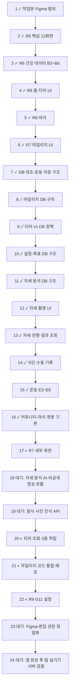

# Figma UI 교체 체크포인트

기준: 2026-10-28 회의록, Figma R5(1차 흐름), R6(2차 화면), R7(3차 화면), R9(다크 모드). 티어 규칙은 R8의 **티어 초안 v1**을 사용한다. View 권한으로 화면은 볼 수 있지만 디자인 속성과 에셋 추출은 막혀 있으므로 첫 구현은 화면 관찰 기준이다.

## 완료

- [x] `front_new` 최신 커밋 `71ad178`을 별도 작업본에 반영했다.
- [x] R5·R6·R7·R9 화면 그룹과 R8 티어 초안 v1 위치를 확인했다.
- [x] R7 G5 마일리지 화면을 잔액 카드, 적립 방법, 전체·적립·사용 내역 구조로 교체했다.
- [x] 오늘 회의의 임시 마일리지 규칙(고강도 운동, 5일·30일 연속 운동)을 프론트 타입·표시에 반영했다.
- [x] R6 G1 마이 화면을 흰 배경의 프로필, 마일리지, 건강 카드, 설정 목록 구조로 교체했다.
- [x] 회의에서 제외하기로 한 사용자 간 메시지 진입점을 커뮤니티 홈과 프로필에서 숨겼다.
- [x] TypeScript 검사와 기존 프론트 테스트를 통과했다.
- [x] R5 A2~A7의 흰 배경 가입 레이아웃, 기본 정보 입력 순서, 필수·선택 동의 시트, 이메일 인증·알레르기·운동 목표 단계를 연결했다.
- [x] R5 A11 목표 상세 화면을 추가하고 주간 운동 계획과 선택적 목표 체중을 기존 API에 저장한 뒤 건강 데이터 업로드로 진입하도록 연결했다.
- [x] R5 B1 건강 데이터 업로드를 촬영·파일 선택, 자료 예시, 선택 파일, 나중에 하기 구조로 교체했다. 기존 파일 검증·업로드·OCR 이동은 유지했다.
- [x] R5 C1 데이터 없는 홈을 흰 배경, 시작 바로가기, 티어 안내, 건강 점수/자료 올리기 카드로 교체했다. 실제 점수가 있으면 API 수치를 표시한다.
- [x] R5 E1 오늘의 운동 설정을 시간·장소·기구·컨디션 선택과 불편 부위 입력 화면으로 교체했다. 기존 추천 생성 API를 연결했다.
- [x] R5 E2 운동 추천을 서버 결과 기반의 요약·추천 이유·운동 목록·운동 시작 화면으로 교체했다.
- [x] R5 I1 공용 확인창을 만들고 가입 첫 화면에서 나갈 때 적용했다.
- [x] R6 B5 OCR 판독 실패 화면을 추가해 촬영 안내와 기존 재업로드 시트를 연결했다. 재업로드 성공 시 다시 결과 확인 화면으로 돌아온다.
- [x] R6 B6 종합 분석 화면의 상단을 흰 배경 점수·티어 카드로 바꾸고, 목표·맞춤 제안 영역을 밝은 카드 구조로 바꿨다. 점수와 분석 내용은 기존 API 응답을 사용한다.
- [x] R6 B3 판독 결과 확인 화면을 흰 배경, 업로드 파일, 자료 유형 탭, 수치 수정 목록 구조로 바꿨다. 연속된 건강검진·인바디 자료는 탭으로 이동하며 기존 OCR 폴링·수정 저장·확인 흐름을 유지했다.
- [x] R6 B4 다시 올리기 시트를 촬영·파일 선택 목록으로 바꾸고 파일 형식·크기 검사를 연결했다. 건강 데이터 관리 화면에서 쓰는 기존 시트 형태는 유지했다.
- [x] R6 C2 데이터가 있는 홈을 티어 안내, 오늘 식단·운동, 이번 주 운동, 분석 바로가기 카드로 교체했다. 식단 열량과 운동 기록은 기존 API·컨텍스트 값을 사용한다.
- [x] R6 C4 내 티어 화면을 밝은 배경의 티어 안내, 실제 건강 점수, 관리 항목, 로드맵으로 교체했다. 이후 R8 활동 티어 조회 API도 연결했다.
- [x] R5·R6·R7·R9 레이어와 실제 Supabase DB를 대조했다. R7 E10·E11에 필요한 저장 운동·사용자 루틴 테이블 2개를 DB에 추가했다.
- [x] 2026-10-28 회의의 고강도 운동·5일·30일 연속 마일리지 임시 규칙을 실제 DB에 적용했다. 거래를 되돌리는 검증에서 적립과 중복 방지를 확인했다.
- [x] R8 티어 초안 v1의 활동 누적 점수를 건강 점수와 분리해 실제 DB에 적용했다. 적립 규칙 6개와 CORE 1~PEAK 3의 15개 구간을 등록하고 적립 한도·중복·경계값을 검증했다.
- [x] R7 G11/G12의 테마·글자 크기·간편 모드 설정과 R7 G7의 목표 유형·선택적 설명 저장 구조를 실제 DB에 적용했다. 기존 목표 텍스트 호출도 유지된다.
- [x] R7 E16~E18 자세 촬영·분석·결과용 DB 테이블 8개를 실제 Supabase에 적용했다. 임시 영상 경로 제거 전 완료 금지, 분석 진행률, 회차·점수·관절·발 좌표·각도·교정·루틴 연결 제약을 검증했다. 초기 트리거 오류는 별도 보정 마이그레이션으로 수정했다.
- [x] R7 E16 스쿼트 자세 촬영 화면을 앱에 추가하고 운동 요약의 스쿼트 항목에서 진입하도록 했다. 카메라 권한, 무음 10초 녹화, 앨범 영상 길이·크기 확인, 재촬영, 앱 캐시 삭제를 연결했다. 분석 AI가 없어 영상은 서버로 전송하지 않는다.
- [x] R6 D1 식단 홈을 날짜·열량·탄단지 목표, 사진 기록 진입, 끼니 카드 구조로 교체했다. 수치는 실제 추천·영양 API 값만 표시하고 추천이 없으면 빈 상태를 보여준다.
- [x] R6 D2·D3·D4의 기록 확인·음식 고치기·사진 인식 불가 화면을 구현했다. 현재 음식 사진 인식 API가 없으므로 임의의 음식 3개를 자동 생성하던 모의 분석을 제거하고 직접 검색·선택·영양 입력 후 기존 식사 피드백 및 사진 저장 API로 기록한다.
- [x] R6 E3 운동 홈을 오늘의 운동·주간 목표·최근 운동 카드로 교체했다. E4 수행 화면과 E5 불편함 시트를 구현하고, E6 결과에서 실제 세션 요약과 운동 후 피드백을 저장한다. 운동 중 자동 루틴 조정 API가 없어 E5에서는 조정 완료를 가장하지 않는다.
- [x] R6 F1 커뮤니티 홈을 추천·팔로잉·클럽 탭, 챌린지 진입 카드, 게시글 목록 구조로 바꿨다. H1 전체 화면 챗봇은 기존 채팅 API를 사용하고 H2 캐릭터 선택은 이 기기에 저장한다. I2 연결 오류 화면을 식단·커뮤니티·챗봇 초기 로드에 적용했다.
- [x] R7 E7 러닝 추천 화면을 지역·거리 입력과 기존 코스 추천 API에 연결했다. E9 운동 기록을 실제 세션 통계와 날짜별 목록으로 바꾸고 추천 운동 저장 버튼을 추가했다. E10 저장한 운동 목록과 E11 직접 루틴 만들기를 본인 소유 API에 연결했다.
- [x] R7 E8 자유 러닝 진행·완료 화면과 본인 소유 러닝 세션 API를 구현했다. 앱 사용 중 GPS 좌표만 받으며 서버가 좌표 간 거리와 평균 페이스를 계산한다. 위치 정확도 저하·급격한 좌표 이동은 거리에서 제외하고, 앱을 벗어나면 일시정지한다. 완료한 러닝은 E9 운동 기록에서 다시 볼 수 있다.

## 전체 진행도 (2026-10-29)

완료 16/24단계. 부분 구현은 완료로 계산하지 않았다.

현재 R6은 19개 화면 중 B3·B4·B5·B6·C2·C4·D1·D2·D3·D4·E3·E4·E5·E6·F1·G1·H1·H2·I2의 19개 UI를 구현했다.
R7 세부 화면은 E7~E15·E19와 F2·F3·F5~F9를 부분 구현했다. G2 프로필 수정, G3 계정 설정, G4 알림 설정 화면도 시안의 흰색 화면 구조로 교체했다. E7의 코스 상세·실제 경로 도식·저장·저장 코스 러닝 시작을 연결했다. G6 건강 리포트는 최근 6개월 실제 건강검진·인바디 수치와 추이 그래프를, G7 건강 목표와 G8 알레르기 설정은 본인 소유 저장 API를, G10 커뮤니티 활동은 내 글 목록을 연결했다. E14의 부위별 처방 데이터, E15의 분석 결과 목록, E19의 전용 캐릭터 음성·음악 볼륨 조절, F4와 F2·F3·F7~F9의 미지원 데이터, G2의 사진·자기소개·직접 신체정보 수정, G3의 로그인 수단 연결·약관 문서, G4의 푸시 설정 저장, G10의 댓글·좋아요·스크랩 목록, G11~G12 실제 설정 및 R9 전체 테마는 아직 완료 조건에 포함되지 않는다.

## 다음 구현

- [ ] R5 화면의 실제 기기 간격·에셋을 편집 권한 확보 후 정밀하게 맞춘다.
- [ ] R7 운동·러닝, 커뮤니티, 마이 세부 화면의 누락된 경로와 기능을 구현한다.
- [ ] E8의 실기기 GPS·장시간 네트워크 전환 검증은 앱 완성 후 팀 테스트에서 수행한다. E7의 AI 코스 응답·경로 검증 실호출도 AI 서버 연결 후 확인한다.
- [ ] 자세 분석 AI가 준비되면 E16 영상을 비공개 임시 저장소로 전송하고 분석 후 Storage API로 삭제한다. E17·E18 화면은 현재 실제 DB 조회 API를 사용하지만 분석 작업 생성 및 촬영 화면에서의 진입은 아직 연결되지 않았다.
- [ ] R8 티어 초안 v1은 조회 API·홈/티어 표시와 식사·추천 운동·확정 건강 자료의 소유자/완료 검증 후 적립을 연결했다. 주간 목표·챌린지·7일 연속 기록 적립과 실패 시 재동기화 경로는 남았다.
- [ ] R7 G7 목표 유형은 저장·조회 API와 화면을 연결했다. G11/G12의 간편 모드 확인·전환을 마이 → 화면 설정에서 사용할 수 있다. R11의 보이는 시안을 기준으로 홈·식단·운동·커뮤니티·마이 탭과 챗봇·레시피·티어·운동 설정·운동 진행·게시글 상세에 큰 글씨·세로 카드·읽어 주기 패턴을 적용했다. R11 전체 세부 화면과 전체 글자 크기 적용은 남았다.
- [ ] R9 다크 모드를 전체 화면에 적용한다. G11 모드 선택은 활성화했고 마이 화면·화면 설정·주간 운동 카드에 즉시 반영한다. 나머지 화면의 R9 색상 적용과 실기기 검증은 남았다.
- [ ] Figma 편집 권한이 생기면 색상, 간격, 폰트, 에셋을 확인해 시안을 정밀하게 맞춘다.
- [ ] 앱 완성 후 팀과 실제 기기 및 서버 연동 테스트를 진행하고 티어·마일리지 수치를 조정한다.

## 연동 확인 필요

- 마일리지 임시 규칙 마이그레이션은 실제 Supabase DB에 적용했다. API 코드와 앱 코드, 커뮤니티 전체 API, 마이그레이션, Render 개발용 설정을 `front_new` 작업본에 합쳤다. `render.yaml`은 이 브랜치를 가리키지만 실제 배포는 하지 않았다. 기본 앱 API 주소가 NCP 기존 서버이므로 새 백엔드 배포·주소 전환 전에는 신규 API를 실호출할 수 없다. 새 3개 규칙을 커뮤니티 내역과 운영자 규칙 API에 추가했다.
- 저장 운동·사용자 루틴 테이블을 다시 확인했고 E9~E11용 본인 소유 API와 앱 화면을 연결했다. API 코드와 앱 코드는 `front_new` 작업본에 합쳤다. 저장 요청은 부모·항목 두 HTTP 요청으로 처리하고 항목 저장 실패 시 보상 삭제를 수행한다. 서버 오류로 정리까지 실패한 경우에는 수동 점검이 필요하다.
- R7 E7 러닝 추천은 기존 `/api/running/courses/recommend`를 호출한다. 코스 AI 서버가 응답하지 않거나 공식 코스가 없어도 별도 자유 러닝을 시작할 수 있다. E8은 이미 적용된 러닝 DB를 사용하고 사용자별 목표 거리·시간·강도·컨디션과 실제 GPS 위치만 저장한다. 백그라운드 위치 권한은 요청하지 않으며, 앱이 화면 밖으로 가면 일시정지한다. GPS 신호가 약한 지점과 갑작스러운 위치 점프는 거리에서 제외한다.
- E7 추천 코스에서 상세를 열어 실제 응답의 좌표로 경로 도식을 표시하고, 서버 서명 토큰으로 전체 스냅샷을 저장한다. 경로 검증이 필요한 공식 메타데이터 코스는 출발·도착 좌표가 있을 때 검증 API를 호출한 뒤 저장한다. 저장 코스에서 시작하는 러닝은 새 본인 소유 세션 API가 해당 저장 코스를 추천 행에 연결하고, E8에서 예정 경로 점선과 실제 GPS 경로를 구분해 표시한다. 도식은 거리 지도가 아니며 길 안내 기능은 없다. AI 서버 설정이 아직 없어 실제 코스 응답·저장·실기기 경로는 팀 테스트 전에 검증하지 못했다.
- 자유 러닝 시작은 기존 DB 제약에 맞춰 사용자 직접 코스 → 추천 행 → 세션 순서로 생성한다. 세 HTTP 요청 중 실패 시 생성한 행을 역순으로 정리하지만, 연결이 끊겨 정리 요청 자체가 실패하면 잔여 행 점검이 필요하다. 위치 수집과 시간·경로 표시의 실기기 검증은 아직 하지 않았다. 칼로리 추정은 검증 기준이 없어 표시하지 않는다.
- R8 누적 활동 티어 DB 정책은 실제 Supabase DB에 적용했다. 기존 100점 건강 점수 및 마일리지와 별도다. 앱은 현재 티어 조회와 식사·추천 운동·확정 건강 자료의 적립 API를 호출한다. 서버는 인증된 소유자·상태와 활성 규칙을 확인하고 DB가 중복·기간 한도를 강제한다. 세 적립 요청은 원본 기록 완료 후 별도로 보내므로 실패 시 기록은 유지되지만 점수 재동기화는 아직 없다. 나머지 세 규칙은 미연결이다.
- R7 G7 건강 목표는 DB/API와 앱 시트를 연결했다. G11은 저장된 화면 모드·글자 크기·간편 모드를 읽어 표시하고, G12 확인 시트에서 간편 모드를 전환한다. 주요 탭과 일부 상세 화면에 간편 모드 표시와 읽어 주기를 적용했다. 앱 전체 테마·글자 크기·간편 모드 적용은 아직 남았다. R7 G7에는 수치형 목표 입력이 보이지 않아 수치 컬럼을 추가하지 않았다.
- R7 E16 촬영 화면은 기기 내 녹화·앨범 선택까지 구현했다. 사용자가 자세 분석 AI가 아직 없다고 확인했으므로 영상을 서버에 올리지 않으며, 화면을 벗어날 때 촬영한 캐시 영상을 지운다.
- R7 E17·E18은 서버의 본인 소유 작업/완료 결과를 읽는 API와 데이터 기반 화면까지 구현했다. 현재 분석 작업을 만드는 API와 모델, 비공개 Storage 업로드·실제 삭제 작업이 없어 촬영 후 결과까지 이어지는 경로는 아직 없다. DB의 삭제 시각은 Storage 삭제 성공 증명이 아니므로 향후 서버가 삭제 성공을 확인하고 완료 상태를 기록해야 한다. 자세 판정 모델과 각도 기준은 미확정이다.
- R7 E12 운동 목표는 기존 목표 API로 저장하고 E13 주간·월간 현황은 완료한 운동 세션과 러닝 세션을 합산한다. 러닝 기록 API에는 본인 소유 날짜 범위 조회를 추가했다. E14는 부위별 처방과 실제 불편 기록이 없어 개인화된 운동 목록을 표시하지 않고 재추천 경로를 제공한다. E15는 스쿼트 촬영·앨범 선택으로 진입하며 분석 모델이 없어 최근 결과를 만들지 않는다.
- R7 E19 음성 설정은 `expo-speech`의 기기 기본 한국어 음성으로 운동 이름·횟수·휴식 시작을 안내하고 속도와 켜짐 상태를 기기에 저장한다. 전용 코치·뤼니 음성 파일과 음악 볼륨 제어는 없어 비활성 안내한다. 음성 출력의 실기기 검증은 앱 완성 후 팀 테스트에서 수행한다.
- R7 F5 알림 목록을 오늘·이번 주·이전 알림과 모두 읽음 동작으로 바꿨다. 현재 알림 API는 팔로우·좋아요·댓글·공유만 반환하므로 챌린지·티어 탭은 준비 상태다. F6 챌린지 상세는 실제 목표·기간·참여·진행·보상 값을 표시하며 참여·취소·보상 신청 API에 연결했다. API에는 날짜별 달성 기록이 없어 시안의 요일별 완료 표시는 만들지 않았다.
- R7 F7 클럽 상세는 실제 분류·클럽장·회원/글 수·글 목록으로 시안의 머리글, 가입/글쓰기, 회원 보기 흐름을 구성했다. 가입한 버튼에서 탈퇴할 때는 확인을 받는다. F8 다른 사람 프로필에는 실제 게시글/팔로워/팔로잉 수, 팔로우와 게시글 목록을 표시한다. 클럽장·다른 사용자 티어, 소개, 공개 루틴, 연결된 운동 기록은 현재 커뮤니티 API 응답에 없어 표시하지 않는다. F7/F8의 정밀 간격·에셋은 Figma 편집 권한 확보 후 조정한다.
- R7 F2 게시글 상세는 실제 본문·사진·작성자 프로필·팔로우·반응·댓글 API를 사용한다. 사진은 상세 화면에서 넘겨 보고 댓글 버튼은 입력창에 초점을 맞춘다. F3 글쓰기는 실제 API 한도인 본문 500자·사진 5장(장당 5MB)으로 업로드하며 완료 후 피드에 반영한다. 시안의 1000자·사진 10장, 게시글 분류, 연결 운동/식단 기록, 태그, 공개 범위, 임시저장은 현 커뮤니티 DB·API에 없어 아직 제공하지 않는다. F2의 연결 루틴 카드와 분류도 해당 데이터 계약이 필요하다.
- R7 F9 클럽 탭은 기존 `GET /api/community/clubs?scope=mine|all`로 ‘내 클럽’과 ‘클럽 찾기’ 목록을 실제 데이터로 전환한다. 카드에는 실제 분류·회원 수·글 수만 표시한다. 시안의 ‘새 글’ 수는 회원별 마지막 읽은 시각이 없으므로 표시하지 않는다. F4 통합 검색은 게시글·루틴·사용자 검색 API와 결과 수·페이지네이션 계약이 없어 구현하지 않았다. 공개 범위와 차단 관계를 반영하는 서버 검색이 필요하며, 현재 첫 페이지를 기기에서 필터링해 전체 검색인 것처럼 보이게 하지 않는다.
- R7 G2는 기존 프로필 API의 이름·닉네임·생년월일·성별만 저장한다. 커뮤니티에 이미 있는 사진은 표시하지만 사진 업로드·자기소개 API는 없으므로 편집을 제공하지 않는다. 키·몸무게는 건강 데이터 관리 화면으로 안내한다. G3는 기존 Supabase 로그인 정보 조회, 이메일 비밀번호 재설정, 로그아웃과 확인 입력이 필요한 계정 삭제를 유지한다. 다른 로그인 수단 연결과 약관 문서 화면은 아직 없다. G4는 푸시 서비스·설정 저장 API가 없어 종류별 알림과 조용한 시간을 비활성 상태로 보여준다.
- R6 D1~D4는 Figma View 화면 관찰을 기준으로 구현했다. Figma MCP는 View 좌석 호출 한도에 걸려 정확한 레이어 속성과 원본 에셋을 받지 못했다. 사진 분석 서버가 없으므로 D4의 직접 입력 경로가 현재 동작하는 흐름이다. D2의 자동 인식 개수와 식단 분석 문구는 생성하지 않는다.
- R6 E3~E6은 Figma View 화면 관찰을 기준으로 구현했다. E5에서 선택한 불편 부위는 서버에 저장되지 않고 남은 루틴도 바뀌지 않는다. 자동 조정 API가 생길 때까지 화면에서 이를 명시하고 운동 중단 또는 이어하기만 제공한다. E6의 수치는 세션 응답만 사용하며 운동 후 느낌·난이도·불편 부위는 기존 피드백 API로 저장한다.
- R6 F1의 세부 게시글 분류는 현재 피드 API에 분류 필드가 없어 화면에서 준비 중으로 표시한다. H2 캐릭터 선택은 로컬에만 저장되고 H1의 표시 캐릭터만 바뀐다. 서버 채팅 API에 캐릭터 설정·계정별 저장 필드가 없어 답변 방식은 바뀌지 않는다. 계정 간 동기화와 실제 말투 적용 시 DB·API 확장이 필요하다.
- 통합본의 운영자 규칙 API `RuleKey`는 새 마일리지 키 3개를 허용한다. 원래 `community-backend` 브랜치는 별도이므로 그 브랜치를 직접 사용할 경우 같은 수정을 옮겨야 한다.
- 최신 `front_new`의 기본 API 주소는 NCP 서버다. 로컬에 Supabase 공개 환경 변수가 없어 로그인부터의 실기기 확인은 아직 진행하지 못했다.
- 통합한 `front_new` 작업본에서 백엔드 802개 테스트, 프론트 TypeScript·lint·12개 단위 테스트, Expo iOS·Android·Web export를 통과했다. 커뮤니티 API 경로 63개와 중복 경로 0개를 확인했다. 검증용 번들은 `/private/tmp/autofit-r7-export-20261029`에만 두었고 서버·앱 배포는 하지 않았다.
- R5 A4의 약관 항목 선택 UI는 추가했지만 약관 원문, 버전, 개별 동의 기록 API가 없다. 가입 전 법적 문서 열람·동의 이력 저장을 출시 전에 연결해야 한다.
- R5 A11의 목표 체중·주간 운동 목표는 기존 DB/API에서 지원한다. 식단 선호도는 현재 온보딩 API에 저장 필드가 없어 아직 입력받지 않는다.
- 운동 목표가 '기타'이면 기존 활성 운동 목표 API가 해당 타입을 지원하지 않아 운동 선호도만 저장한다.
- R5 C1의 '오늘 할 일'은 현재 홈 API에 목록·완료 상태가 없다. 홈에는 운동·식단·커뮤니티 진입 바로가기를 표시하고 실제 할 일 3개로 계산하지 않는다.
- R5 E1의 '맨몸' 선택은 현재 프론트 매핑에서 서버의 'mat' 장비 코드로 전송된다. 실제 추천 규칙에서 두 개념을 같은 것으로 취급할지 확인해야 한다.
- R6 B6의 티어 표시는 화면별 기존 UI가 남아 있을 수 있다. 홈·내 티어 화면은 누적 활동 티어 조회 API 값을 표시하고 Figma 예시 점수를 사용자 데이터처럼 표시하지 않는다.
- R6 C2의 식단 열량은 영양 요약 API, 이번 주 운동 횟수는 운동 진행 API에서 읽는다. 홈 API에는 티어 단계·진행률 및 오늘 운동 목표 시간이 없어 해당 수치를 임의로 만들지 않았다.

## 2026-10-29 커뮤니티 F2~F5 후속 작업

- F4 검색: 게시글·루틴·사용자·클럽의 서버 검색과 앱 검색 화면을 추가했다. 공개 피드 글에만 본문·태그·운동명 검색을 적용하고, 차단·신고·숨김 글은 제외한다. 검색 결과는 종류별 최대 10개이며 전체 건수·다음 페이지는 아직 없다.
- F3 글쓰기: 1,000자 본문, 분류 5종, 태그 최대 5개, 기기 내 텍스트 임시저장을 연결했다. 사진과 운동 기록 선택은 임시저장에 포함되지 않는다. 사용자가 직접 선택한 완료 운동 세션만 공개 카드로 첨부할 수 있다.
- F2 게시글: 분류·태그와 공개 운동명·시간·열량·운동 목록 카드를 표시한다. 시안의 댓글 대댓글과 공유 루틴을 내 루틴으로 담는 동작은 남았다.
- F1 피드: 분류별 조회를 서버 페이지네이션에 연결했다. F5는 기존 팔로우·좋아요·댓글·공유 알림만 지원하므로 챌린지·티어 알림은 남았다.
- 위 DB 마이그레이션 두 건은 Supabase 프로젝트에 적용하고 읽기 RPC를 확인했다. 백엔드 변경은 로컬 작업본에만 있어 NCP 기본 API와 Render 백업 API에 배포되기 전까지 Expo Go에서 신규 API를 사용할 수 없다.
- 서버 역할 확인: 네이버 공용 API는 별도 서버 담당자가 관리하고, 이 컴퓨터에서 접근 가능한 Render는 백업 API다. 네이버 서버 담당자에게는 앱·API 전체 작업과 Render 검증이 끝난 뒤 최종 전달본을 한 번에 보낸다. 그때까지 공용 서버 배포는 보류한다. 전달 초안은 `docs/api-server-handoff-20261029.md`에 보관한다. 현재 Render는 GitHub `backend` 브랜치의 기존 커밋을 실행 중이다.
